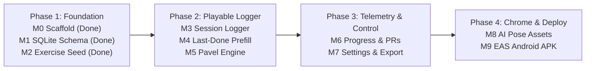

## Build Roadmap Overview

| Milestone                   | Status     | Focus                                                                           |
| :-------------------------- | :--------- | :------------------------------------------------------------------------------ |
| **M0 — Scaffold**           | ✅ Landed  | Expo SDK 58 app shell, 5 shadow themes, tab/session routes, CT & CI harness     |
| **M1 — SQLite Layer**       | ✅ Landed  | `expo-sqlite` v1 schema, migrations, serialized write queue, repo helpers       |
| **M2 — Exercise Seed**      | ✅ Landed  | `core-kit-exercises.json` + public dataset import & `availableEquipment` filter |
| **M3 — Session Logger**     | ⏳ Next    | Log sets (`reps`/`weight` or `duration_sec`), checkoff, haptic rest timer       |
| **M4 — Last-Done Prefill**  | 📋 Planned | Automatic pre-fill from most recent working sets per exercise                   |
| **M5 — Progression Engine** | 📋 Planned | `suggestNext()` deterministic rules + unit test suite & UI suggestion chips     |
| **M6 — Progress View**      | 📋 Planned | Weekly volume/time chart + Personal Records (PR) table                          |
| **M7 — Settings & Export**  | 📋 Planned | Kit toggles, fixed KB weight, goal/units, and schema v1 JSON export             |
| **M8 — First Image Batch**  | 📋 Planned | 25–30 core-kit start/end cyberpunk WebP illustrations + fallback card           |
| **M9 — Distribution Build** | 📋 Planned | EAS internal Android APK build & survival across restarts                       |
