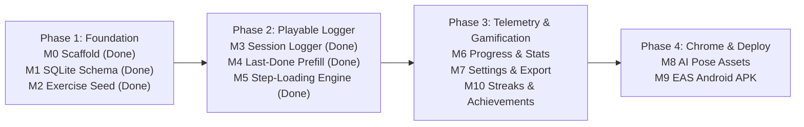

## Build Roadmap Overview

| Milestone                    | Status     | Focus                                                                           |
| :--------------------------- | :--------- | :------------------------------------------------------------------------------ |
| **M0 — Scaffold**            | ✅ Landed  | Expo SDK 58 app shell, 5 shadow themes, tab/session routes, CT & CI harness     |
| **M1 — SQLite Layer**        | ✅ Landed  | `expo-sqlite` v1 schema, migrations, serialized write queue, repo helpers       |
| **M2 — Exercise Seed**       | ✅ Landed  | `core-kit-exercises.json` + public dataset import & `availableEquipment` filter |
| **M3 — Session Logger**      | ✅ Landed  | Log sets (`reps`/`weight` or `duration_sec`), checkoff, haptic rest timer       |
| **M4 — Last-Done Prefill**   | ✅ Landed  | Automatic pre-fill from most recent working sets per exercise                   |
| **M5 — Progression Engine**  | ✅ Landed  | `suggestNext()` deterministic rules + unit test suite & UI suggestion chips     |
| **M6 — Progress & Stats**    | ⏳ Next    | `Last Workout`/`Week`/`Month` + `◀/▶` scrubber, intensity heatmap & PR table    |
| **M7 — Settings & Trainers** | 📋 Planned | 5-Trainer Dossier & Split selector, kit toggles, 1-file JSON I/O + CSV log      |
| **M8 — Trainer HD & Poses**  | 📋 Planned | 5 sharp HD Trainer portraits + 25–30 core-kit specialist WebP illustrations     |
| **M9 — Distribution Build**  | 📋 Planned | EAS internal Android APK build & survival across restarts                       |
| **M10 — Creds & Streaks**    | 📋 Planned | Creds (`¥`) mission economy to unlock all 5 Trainers + weekly streaks & badges  |
