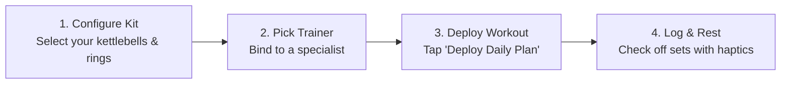
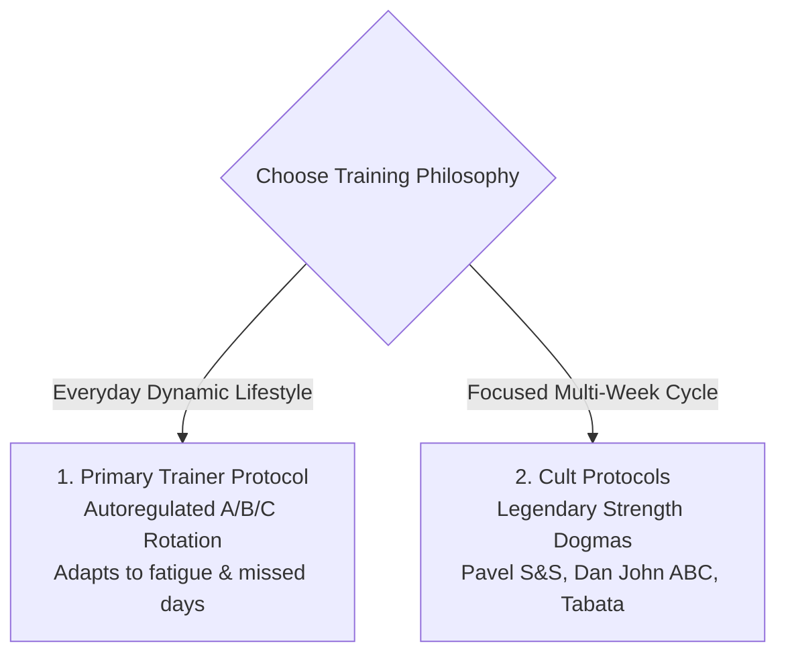
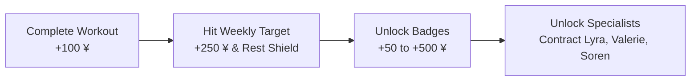

# ─── [ SHADOW OPERATOR MANUAL // FIELD GUIDE ] ───

> **CLASSIFIED FIELD DEPLOYMENT MANUAL // ALL RUNNERS**  
> _"Welcome to the shadows, chummer. ShadowTrain is an offline-first, cyber-minimalist strength and conditioning engine designed for runners, calisthenics athletes, and kettlebell operators. No cloud subscriptions. No tracking beacons. Pure deterministic progression."_

---

## ⚡ Quick Start (T-Minus 60 Seconds)

Get your deck configured and deploy your first run in under one minute:



### Step 1: Armory Setup (Settings Tab)

1. Open the **Settings** tab (gear icon on bottom right).
2. Under **Minimalist Core Kit**, toggle what gear you own:
   - **Kettlebells**: Select your available bells (e.g., `16kg`, `24kg`, `32kg`).
   - **Bodyweight & Calisthenics**: Toggle pull-up bar, dip station, or parallettes.
   - **Gymnastic Rings**: Toggle suspension straps.
   - **Speed Rope**: Toggle jump rope for conditioning.
   - **Grippers**: Toggle crushing grip trainers.
3. Choose your **Weekly Frequency Target** (e.g. `3`, `4`, or `5` days/week).

### Step 2: Choose Your Primary Specialist

- On first boot, you are assigned **Kaelen Vorga (Orc Merc)** or **Unit-0 (Sparring Drone)**.
- Each specialist tailors their workouts to their discipline (Heavy Iron, Jump Rope & Core, Military Calisthenics, Astral Mobility, or Rings).

### Step 3: Deploy Your First Mission

- Switch to the **Daily Deck** (Home tab).
- You will see today's auto-generated **Planned Workout** (with your specialist's voice and variant).
- Tap **"DEPLOY DAILY PLAN"** to open the active session logger.

---

## 🏋️ The Active Workout Loop: Step-by-Step

Logging sets in ShadowTrain is frictionless, high-contrast, and tuned for sweaty fingers.

### 1. The Screen Layout & Movement Cards

When a workout is active, each exercise is rendered inside a high-contrast cyberpunk chassis:

- **Specialist Header & Avatar**: Displays the movement's designated trainer. Tapping the avatar expands a full-screen view.
- **START & END Frame Demonstrator**: Visual pictograms displaying exact biomechanical alignment. Tapping any frame opens a high-resolution plate.
- **Target Progression Chip**: A neon pill indicating your target for today (e.g., `+2 reps`, `+1 set`, `Ramp Back -30%`, or `Hold +15s`).

### 2. Logging Sets & The Progression Chip

| Movement Type                 | Fields Displayed           | Example Entry        | Progression Action                                       |
| :---------------------------- | :------------------------- | :------------------- | :------------------------------------------------------- |
| **Kettlebell Strength**       | `Weight (kg)` & `Reps`     | `24 kg × 5 reps`     | Next session: suggests `+1 rep` until top of step ladder |
| **Bodyweight Holds**          | `Duration (sec)`           | `45s`                | Next session: suggests `+15s` until target time hit      |
| **Speed Rope / High-Cadence** | `Duration (sec)` or `Reps` | `120s` or `100 reps` | Escalates time or sets                                   |
| **Ascending Ladders**         | `Reps per rung`            | `1, 2, 3 reps`       | Increases ladder density                                 |

- **Auto-Prefill (Last Done)**: When you open an exercise you have completed before, ShadowTrain automatically pre-fills your previous working weight and reps.
- **Check-off Circle**: Tap the circular checkmark `[✓]` once the set is complete. The set locks in and glows green.

### 3. The Smart Rest & Interval Timer

- As soon as you check off a set, the **Haptic Rest Countdown** immediately triggers.
- The default rest (e.g. `60s` or `90s`) ticks down in real time with an amber progress ring.
- You can add or subtract `+30s` / `-30s` with a single tap, or skip the rest period if you are ready early.
- High-intensity haptic vibration alerts you when rest expires so you never need to stare at your screen.

### 4. Jacking Out (Completing the Session)

1. When all target sets are complete, scroll to the bottom and tap **"COMPLETE RUN"**.
2. Select your session **RPE (Rate of Perceived Exertion)** from 1 to 10:
   - `6 - 7`: Moderate effort / reserve left.
   - `8`: Hard working sets / 1–2 reps in reserve (ideal target).
   - `9 - 10`: Maximal grind / failure.
3. Tap **"SAVE TO DATABASE"**:
   - The session commits directly to on-device SQLite.
   - Your weekly streak updates.
   - Creds (`¥`) and achievement XP are awarded.

---

## ⚔️ Programming Modes: Dynamic Trainer vs. Cult Protocols

ShadowTrain gives you two distinct philosophies to build your week:



### Mode 1: Primary Trainer Protocol (Adaptive Autoregulation)

- **Best For**: Your ongoing weekly training split.
- **How It Works**:
  - Automatically cycles across **3 distinct variants (A, B, C)** to prevent overuse injuries and movement stagnation.
  - Detects fatigue: if yesterday's session was rated `RPE 9+`, today's volume is automatically reduced by ~30% with added restorative mobility (`recovery_fatigue`).
  - Detects layoffs: if you missed 5+ days, it applies `ramp_back` mode to safely ease your connective tissue back into intensity.
  - Matches your target frequency: whether you train 2, 3, 4, or 5 days per week, the engine balances push, pull, hinge, and squat patterns cleanly.

### Mode 2: Cult Protocols (Fixed Dogma & Interval Workouts)

- **Best For**: 4–8 week focused challenges or conditioning tests.
- Accessible directly from the **Program Selector**:

| Cult Protocol               | Author & Origin                   | Signature Recipe                                            | Timer Mode               |
| :-------------------------- | :-------------------------------- | :---------------------------------------------------------- | :----------------------- |
| **Simple & Sinister (S&S)** | Pavel Tsatsouline // StrongFirst  | 10×10 Swings + 10 Turkish Get-Ups                           | EMOM (60s rounds)        |
| **Rite of Passage (ROP)**   | Pavel Tsatsouline // ETK          | Clean & Press ladders (1, 2, 3) + Pull-ups + Snatch cadence | 90s Rest cadence         |
| **Armor Building Complex**  | Dan John // Tactical Strength     | 2 Cleans + 1 Press + 3 Front Squats                         | EMOM (continuous rounds) |
| **Convict Calisthenics**    | Paul Wade // Convict Conditioning | Big Six mastery (Upper Power vs. Lower/Core)                | Rest countdown           |
| **Tabata Conditioning**     | Prof. Izumi Tabata                | 20s Max Sprint / 10s Rest × 8 rounds                        | Tabata Interval HUD      |

---

## ⚙️ The Progression Engine Demystified

Tired of spreadsheet apps that ask you to add `0.5 kg` to a kettlebell you don't own? ShadowTrain's engine is built for real-world equipment constraints.

### 1. Step-Loading for Fixed Kettlebells

When training with fixed bells (e.g. 16kg, 24kg, 32kg), you cannot make tiny weight jumps. Instead, the engine step-loads **volume** before weight:

```
Step 1: 5 sets × 5 reps @ 24kg  (25 reps total)
Step 2: 5 sets × 6 reps @ 24kg  (30 reps total)
Step 3: 5 sets × 8 reps @ 24kg  (40 reps total)
Step 4: 5 sets × 10 reps @ 24kg (50 reps total)
Step 5: WEIGHT JUMP → 5 sets × 5 reps @ 32kg
```

Only when you dominate the top of the step ladder does the chip suggest jumping to your next available bell.

### 2. Timed Holds (+15s Bricks)

For isometric exercises (Planks, L-Sit holds, Hollow Body holds) and jump rope:

- Progressions advance in **+15 second blocks** once you hit the target cleanly at `RPE ≤ 8`.
- If you struggle, the target holds steady to consolidate tendon resilience.

---

## 💰 Cyber Economy, Streaks & Rest Shields



- **Creds (¥)**: The shadow currency earned purely through sweat. No real-money transactions.
  - `+100 ¥` per completed training run.
  - `+250 ¥` for completing your weekly target frequency.
  - `+50 ¥ to +500 ¥` for leveling up achievements.
- **Unlocking Specialists**:
  - **Valerie "Glitch" Vance**: 1,000 ¥
  - **Marcus "Vanguard" Kade**: 2,000 ¥
  - **Lyra "Aether" Vael**: 3,500 ¥
  - **Soren "Wraith" Kael**: 5,000 ¥
- **Rest Shields**: Taking planned rest days is part of elite training. When you hit your weekly target days, a **Rest Shield** is activated, protecting your streak from breaking during recovery weeks.

---

## 💾 100% Local-First & Data Sovereignty

Your biometric data belongs to you. Period.

- **Offline SQLite**: All sets, sessions, PRs, and notes are written to an encrypted, on-device SQLite database with write-ahead logging (WAL).
- **Zero Cloud / Zero Telemetry**: The app functions 100% offline in airplane mode or deep subterranean gym bunkers.
- **1-Click JSON Backup & Restore**:
  - Open **Settings** → **Data Portability**.
  - Tap **"Export Full Database (JSON)"** to save a human-readable backup to your phone's file storage.
  - To restore or transfer to a new device, tap **"Import Backup"**.

---

## ❓ Frequently Asked Questions (FAQ)

#### Q: How do I change the weight of an exercise if the suggestion is too heavy?

> Simply tap the weight input box on any set card and type your actual weight. The next session's engine will calibrate automatically from what you actually lifted.

#### Q: What if an exercise hurts or I lack the equipment today?

> Tap the **"Replace Exercise"** or **"Add Exercise"** button in the session sheet to swap in any movement from your armory.

#### Q: Can I run both a Cult Program and my Primary Trainer?

> Yes! You can run Pavel's _Simple & Sinister_ as your main workout, and on other days deploy your Primary Trainer's mobility or core session.

#### Q: How do I view full-size character artwork and exercise demonstrations?

> In the app, tap any trainer avatar or exercise START/END frame to trigger the full-screen modal. In this documentation site, check the **[Shadow Dossier](/trainers/)** section for uncompressed 8K studio plates.

---

_Stay frosty, chummer. Lock in your sets and conquer the sprawl._
